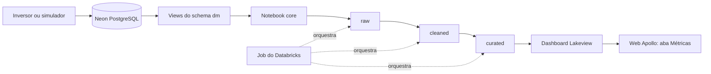

<div align="center">

# ☀️ Apollo BI

### Métricas de saúde e sustentabilidade dos ativos solares do Apollo

Pipeline de dados em arquitetura medalhão no **Databricks**, que lê o data mart do
Apollo no Neon, calcula os KPIs e os índices de sustentabilidade (IS) e alimenta o
dashboard embutido na web.

[](https://www.databricks.com/)
[](https://spark.apache.org/docs/latest/api/python/)
[](https://neon.tech/)
[](https://delta.io/)
[](https://docs.databricks.com/aws/en/repos/)

</div>

---

## Sobre o projeto

O **Apollo** é uma plataforma SaaS multi-tenant para gestão do ciclo de vida de
ativos fotovoltaicos em empresas industriais. O inversor mede o desempenho de cada
string, e o Apollo usa esse dado real para gerar alertas, ordens de serviço e
realocações de placas.

O **Apollo BI** é a camada de análise dessa plataforma. Ele lê o data mart do Apollo
no Neon, trata os dados em três camadas e calcula os KPIs e os índices que aparecem
na aba **Métricas** da web. O **Gerente** e o **Analista** acessam o dashboard e veem
apenas a própria filial.

> A unidade monitorada no Apollo é a **string**. A hierarquia dos ativos é:
> empresa, filial, inversor, string e placa.

## Dados de origem

A fonte é o banco do Apollo no Neon (PostgreSQL, 24 tabelas). O BI não lê as tabelas
operacionais direto: ele lê o schema **`dm`** (data mart), que expõe 20 views.

| Tipo | Views do `dm` |
|---|---|
| Dimensões | `dim_company`, `dim_segment`, `dim_company_unit`, `dim_panel_model`, `dim_inverter`, `dim_string`, `dim_panel`, `dim_employee`, `dim_date`, `dim_maintenance_type`, `dim_part` |
| Fatos | `fact_string_daily_performance`, `fact_string_health`, `fact_maintenance`, `fact_part_consumption`, `fact_daily_active_user`, `fact_warning`, `fact_relocation`, `fact_stock` |
| Apoio | `vw_maintenance_chain` (cadeia de OS filhas, usada para medir retrabalho) |

As views `dim_maintenance_type`, `dim_part`, `fact_warning`, `fact_relocation` e
`fact_stock` foram criadas para o BI. O script está em `dm_novas_views.sql`.

As medições por string (`power_w`, `voltage_v`, `current_a`, `generated_energy_kwh`,
`fault_code`) vêm do inversor. Na demonstração, elas são geradas por um simulador, e
a coluna `data_source` registra a origem de cada leitura.

## Índices de sustentabilidade (IS)

| Índice | O que mede | Situação |
|---|---|---|
| **IS Energético** | Queda brusca na captação e desempenho abaixo do padrão da etiqueta do equipamento | Calculado |
| **IS Ambiental** | Vida útil do painel, usando a garantia do modelo de placa como vida útil | Calculado (precisa de `warranty_years` preenchido no `panel_model`) |
| **IS Financeiro** | Custo do painel comparado ao que seria pago de energia sem o sistema | Fora do cálculo: não existem consumo e tarifa no banco |
| **IS Geral** | Média dos IS calculados (Energético e Ambiental), por filial | Calculado |

Regras de cálculo definidas pelo grupo:

- Tudo o que não existir no banco atual fica de fora do cálculo. O schema não será alterado para isso;
- cada IS é calculado por string e depois agregado por filial;
- não existe tabela por painel na camada final.

Como cada IS é calculado:

- **IS Energético:** média de dois percentuais por string. O primeiro é a parcela dos
  dias com pico de potência dentro do padrão da etiqueta (`peak_to_nominal_ratio`).
  O segundo é a parcela das medições de saúde sem queda brusca (`health_delta`);
- **IS Ambiental:** parcela da garantia que ainda resta, a partir da idade média das
  placas instaladas e ativas da string.

## KPIs calculados

Além dos IS, a camada `curated` entrega KPIs para o dashboard:

| Tabela da `curated` | Conteúdo |
|---|---|
| `kpi_saude_string`, `kpi_saude_filial`, `kpi_saude_diaria_filial` | Saúde atual, % de strings abaixo de 70 e evolução diária |
| `kpi_producao_filial_mes` | Energia gerada, kWh por kWp e leituras com falha |
| `kpi_manutencao_filial_mes`, `kpi_os_por_tipo` | Status das OS, atrasadas, tempo de resolução, custo, desvio de orçamento, cancelamento e retrabalho |
| `kpi_ativos_filial` | Placas por status e taxa de ativação |
| `kpi_alertas_filial` | Alertas por status, alertas sem OS e horas até a OS |
| `kpi_realocacao_filial` | Solicitações de realocação, internas e externas |
| `kpi_estoque_peca`, `kpi_estoque_filial` | Estoque de peças e itens abaixo do mínimo |
| `kpi_is_string`, `kpi_is_filial` | IS Energético, IS Ambiental e IS Geral |
| `dim_filial_mapa` | Cidade, estado e indicadores de risco de cada filial |

Parâmetros do cálculo, na célula de parâmetros do notebook `apollo_curated`:

| Parâmetro | Valor | Situação |
|---|---|---|
| `LIMIAR_SAUDE` | 70 | Definido no projeto |
| `PADRAO_MIN` | 0,80 | A definir pelo grupo |
| `QUEDA_BRUSCA_PTS` | 5 | A definir pelo grupo |
| `META_IS` | 80 | A definir pelo grupo |
| `META_RESOLUCAO_DIAS` | 7 | A definir pelo grupo |

## Funcionalidades previstas

- Conexão com o Neon por JDBC, com credenciais em um arquivo `.env` lido com `python-dotenv`;
- ingestão das 20 views do `dm` sem alteração na camada `raw`;
- limpeza na camada `cleaned`: nulo escrito como texto vira nulo e linhas com chave nula são removidas;
- cálculo dos KPIs e dos IS na camada `curated`;
- dashboard (Lakeview) embutido na aba Métricas da web;
- acesso restrito por filial (Row Filter) para Gerente e Analista;
- Job no Databricks para executar o pipeline sem rodar célula por célula;
- relatório gerencial com o fluxo do pipeline e a relação com os KPIs.

## Arquitetura

O fluxo segue a arquitetura medalhão, com nomes descritivos para cada camada:



| Camada | Equivalente medalhão | O que contém |
|---|---|---|
| `raw` | Bronze | Cópia fiel das 20 views do `dm`, sem alterar os dados |
| `cleaned` | Silver | As mesmas 20 tabelas, com nulo escrito como texto convertido em nulo e sem linhas de chave nula |
| `curated` | Gold | KPIs e IS por string e por filial, prontos para o dashboard |

```text
apollo-bi/
├── apollo-core/
│   ├── apollo_connection_neon_core    # Conexão com o Neon, lista de views e criação dos schemas
│   └── apollo_connection_test         # Teste da conexão (conta as views e mostra os dados)
├── apollo-pipeline/
│   ├── apollo_raw                     # Neon (dm) para a camada raw
│   ├── apollo_cleaned                 # raw para a camada cleaned
│   └── apollo_curated                 # cleaned para a camada curated (KPIs e IS)
├── apollo_manager/                    # Dashboard principal (a criar)
└── README.md
```

As tabelas são salvas como `workspace.raw`, `workspace.cleaned` e
`workspace.curated`. O catálogo, o schema de origem e a lista de views ficam nas
variáveis do notebook core.

## Tecnologias

| Tecnologia | Uso no projeto |
|---|---|
| Databricks | Execução dos notebooks, Jobs e dashboard Lakeview |
| PySpark | Leitura, tratamento e transformação dos dados |
| Delta Lake | Armazenamento das tabelas de cada camada |
| Neon (PostgreSQL) | Banco operacional do Apollo, fonte do BI |
| JDBC | Conexão entre Databricks e Neon |
| python-dotenv | Leitura das credenciais do Neon a partir do arquivo `.env` |
| React | Web do Apollo, onde o dashboard é embutido |
| GitHub | Versionamento e revisão do código |

## Como executar

### Pré-requisitos

- Conta própria no Databricks Free Edition (cada integrante usa a sua);
- Conta no GitHub com permissão de escrita neste repositório;
- Personal Access Token do GitHub com escopo `repo`;
- as views do `dm` criadas no Neon (inclusive as 5 novas, de `dm_novas_views.sql`).

> Não é preciso instalar nada na máquina. Todo o processamento roda no Databricks.

### 1. Conecte o GitHub ao Databricks

No Databricks, acesse **Settings > Linked accounts > Git integration**, escolha
GitHub e informe o seu Personal Access Token.

### 2. Crie a Git folder

Em **Workspace > Create > Git folder**, cole a URL do repositório e confirme:

```text
https://github.com/<ORGANIZACAO>/<REPOSITORIO>.git
```

Depois, troque para a sua branch no menu de branches, no topo da pasta.

### 3. Configure as credenciais do Neon

Cada integrante cria o seu arquivo `.env` com o host, o banco, o usuário e a senha
do Neon. Os nomes das variáveis são os que o `apollo_connection_neon_core` lê. Os
valores vêm da connection string do projeto no painel do Neon.

> O `.env` fica fora do repositório. Nunca escreva credenciais em notebooks, commits
> ou mensagens do grupo.

### 4. Teste a conexão

Abra `apollo-core/apollo_connection_test` e use **Run all**. O resultado esperado é
a contagem das 20 views do `dm` e a exibição dos dados.

### 5. Execute o pipeline

Rode os notebooks de `apollo-pipeline` nesta ordem:

1. `apollo_raw`
2. `apollo_cleaned`
3. `apollo_curated`

## Configuração do notebook core

| Variável | Padrão | Descrição |
|---|---|---|
| `CATALOG` | `workspace` | Catálogo onde as camadas são criadas |
| `NEON_SCHEMA` | `dm` | Schema de origem no Neon, onde ficam as views do data mart |
| `VIEWS` | 20 views do `dm` | Lista das views que a `raw` copia do Neon |

## Requisitos da disciplina: Business Intelligence

Esta seção relaciona a implementação aos critérios definidos para a disciplina em
maio de 2026.

| Requisito | Situação | Evidência no projeto |
|---|:---:|---|
| Dashboard conectado à fonte de dados da aplicação | ⏳ | Será construído sobre a camada `curated` |
| Gráficos de barra e linha | ⏳ | Evolução da saúde, produção e manutenção por filial e mês |
| Cards de KPIs e desvios | ⏳ | Saúde contra o limiar de 70, IS Geral contra a meta, tempo de resolução contra a meta |
| Histogramas e boxplots | ⏳ | Distribuição da saúde das strings e do tempo de resolução das OS |
| Mapa, se houver dados geográficos | ⏳ | `dim_filial_mapa` traz cidade e estado; não há latitude e longitude, então o mapa é por cidade ou estado |
| Filtros interativos (período, filial) | ⏳ | Planejado no dashboard |
| Relatório gerencial | ⏳ | Apresentação da base, problema, tratamento e KPIs |
| Pipeline no Databricks (leitura, tratamento, KPIs, base final) | 🚧 | `apollo_raw`, `apollo_cleaned` e `apollo_curated` escritos; falta executar a cleaned e a curated com as 20 views |
| Pipeline usando a fonte gerada pela aplicação | ✅ | `apollo_raw` lê o schema `dm` do Neon |
| Job para executar o pipeline sem rodar célula por célula | ⏳ | Planejado |
| Evidências do Job (configuração, histórico, status, resultado) | ⏳ | Planejado |

**Legenda:** ✅ concluído · 🚧 em desenvolvimento · ⏳ planejado

## Próximos passos

- Incluir as 5 views novas em `VIEWS` no notebook core e executar o `apollo_raw` com as 20 views;
- executar o `apollo_cleaned` e conferir as linhas removidas por tabela;
- preencher `warranty_years` no `panel_model` para o IS Ambiental sair do nulo;
- definir em grupo `PADRAO_MIN`, `QUEDA_BRUSCA_PTS`, `META_IS` e `META_RESOLUCAO_DIAS`;
- executar o `apollo_curated` e validar as tabelas geradas;
- criar o Job com as três etapas em sequência;
- construir o dashboard a partir da base `curated`;
- adicionar o Row Filter por filial quando os dashboards estiverem finalizados;
- deixar o React pronto para receber o embed e ativar o trial de 14 dias do Databricks de 4 a 5 dias antes da apresentação;
- escrever o relatório gerencial com o fluxo do pipeline e a relação com os KPIs.

## Contribuição

Regras para todo o grupo:

1. **Nunca edite na `main`.** Cada pessoa trabalha em uma branch própria;
2. antes de começar, faça **Pull** da `main` e crie a sua branch: `feat/<seu-nome>-<assunto>`;
3. avise o grupo qual notebook você vai editar, para evitar conflito de merge;
4. faça commits curtos e claros, seguindo o padrão
   [Conventional Commits](https://www.conventionalcommits.org/pt-br/v1.0.0/);
5. envie a branch (**Push**) e abra um **Pull Request** descrevendo a alteração;
6. outra pessoa do grupo revisa e faz o merge na `main`.

Fluxo do dia a dia:

1. Abra a sua Git folder e faça **Pull**;
2. confirme que está na sua branch;
3. edite apenas o notebook combinado e rode para testar;
4. faça **Commit & Push** e abra o Pull Request.

Os notebooks são versionados em formato `.py`, o que mantém o diff legível no GitHub.

---

<div align="center">

Desenvolvido pela equipe **Apollo** para o Projeto Interdisciplinar 2026. 🚀

</div>
