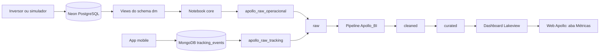

<div align="center">

# ☀️ Apollo BI

### Métricas de saúde e sustentabilidade dos ativos solares do Apollo

Pipeline de dados em arquitetura medalhão no **Databricks**, que lê o data mart do
Apollo no Neon e o tracking do app mobile no MongoDB, calcula os KPIs e os índices de
sustentabilidade (IS) e alimenta o dashboard embutido na web.

[](https://www.databricks.com/)
[](https://spark.apache.org/docs/latest/api/python/)
[](https://neon.tech/)
[](https://www.mongodb.com/atlas)
[](https://delta.io/)
[](https://docs.databricks.com/aws/en/repos/)

</div>

---

## Sobre o projeto

O **Apollo BI** é a camada de análise da plataforma SaaS multi-tenant Apollo. Ele lê o data mart do Apollo
no Neon e o tracking do app mobile no MongoDB, trata os dados em três camadas e calcula os KPIs e os índices que aparecem
na aba **Métricas** da web. O **Gerente** acessa o dashboard e vê
apenas a própria filial.

> A unidade monitorada no Apollo é a **string**. A hierarquia dos ativos é:
> empresa, filial, inversor, string e placa.

## Dados de origem

O pipeline tem duas fontes, cada uma com a sua trilha de código:

| Fonte | Trilha | O que traz |
|---|---|---|
| Neon (PostgreSQL), schema `dm` | `operacional` | Dados operacionais do Apollo: ativos, saúde, manutenção, alertas, realocação e estoque |
| MongoDB, coleção `tracking_events` | `tracking` | Eventos de uso do app mobile: telas, ações de toque, chamadas de API e sessões |

### Neon: dados operacionais

A fonte é o banco do Apollo no Neon (PostgreSQL, 32 tabelas). O BI não lê as tabelas
operacionais direto: ele lê o schema **`dm`** (data mart), que expõe 20 views.

| Tipo | Views do `dm` |
|---|---|
| Dimensões | `dim_company`, `dim_segment`, `dim_company_unit`, `dim_panel_model`, `dim_inverter`, `dim_string`, `dim_panel`, `dim_employee`, `dim_date`, `dim_maintenance_type`, `dim_part` |
| Fatos | `fact_string_daily_performance`, `fact_string_health`, `fact_maintenance`, `fact_part_consumption`, `fact_daily_active_user`, `fact_warning`, `fact_relocation`, `fact_stock` |
| Apoio | `vw_maintenance_chain` (cadeia de OS filhas, usada para medir retrabalho) |

As views `dim_maintenance_type`, `dim_part`, `fact_warning`, `fact_relocation` e
`fact_stock` foram criadas para o BI.

As medições por string (`power_w`, `voltage_v`, `current_a`, `generated_energy_kwh`,
`fault_code`) vêm do inversor. Na demonstração, elas são geradas por um simulador, e
a coluna `data_source` registra a origem de cada leitura.

### MongoDB: tracking do mobile

A coleção `tracking_events` guarda um documento por evento do app. Os campos aninhados
em `properties` são achatados para colunas (`properties_duration_ms`,
`properties_http_status` e outras).

| Evento (`event_name`) | O que registra |
|---|---|
| `app_opened`, `app_foregrounded` | Abertura e retorno do app |
| `screen_viewed`, `screen_exited` | Tela exibida e tempo de permanência |
| `ui_action` | Toque do usuário (alvo e forma de entrada) |
| `api_request_completed` | Chamada de API (endpoint, status HTTP e latência) |

O tracking traz `company_id`, mas não a filial. Por isso os KPIs dele são por empresa.

## Índices de sustentabilidade (IS)

| Índice | O que mede | Situação |
|---|---|---|
| **IS Energético** | Queda brusca na captação e desempenho abaixo do padrão da etiqueta do equipamento | Calculado |
| **IS Ambiental** | Vida útil do painel, usando a garantia do modelo de placa como vida útil | Calculado (se o modelo não tem `warranty_years`, vale `VIDA_UTIL_PADRAO_ANOS`) |
| **IS Financeiro** | Custo do painel comparado ao que seria pago de energia sem o sistema | Fora do cálculo: não existem consumo e tarifa no banco |
| **IS Geral** | Média dos IS calculados (Energético e Ambiental), por filial | Calculado |

Regras de cálculo definidas pelo grupo:

- Tudo o que não existir no banco atual fica de fora do cálculo. O schema não será alterado para isso;
- cada IS é calculado por string e depois agregado por filial, no total do histórico (`kpi_is_filial`) e por dia (`kpi_is_filial_diario`);
- não existe tabela por painel na camada final.

Como cada IS é calculado:

- **IS Energético:** média de dois percentuais por string. O primeiro é a parcela dos
  dias com pico de potência dentro do padrão da etiqueta (`peak_to_nominal_ratio`).
  O segundo é a parcela das medições de saúde sem queda brusca (`health_delta`);
- **IS Ambiental:** parcela da vida útil que ainda resta, a partir da idade média das
  placas instaladas e ativas da string. A vida útil é a garantia do modelo de placa
  (`warranty_years`). O dataload atual do banco não preenche esse campo, então o pipeline
  usa `VIDA_UTIL_PADRAO_ANOS` nesses casos; com valor 0 o IS Ambiental fica vazio.

IS por dia: as mesmas regras valem para cada dia. O IS Energético usa as leituras e as
medições do dia, e o IS Ambiental usa as placas já instaladas e ainda ativas naquele dia.
O IS de uma semana ou de um mês é a média dos IS diários do período, calculada no
dashboard. O IS acumulado (`kpi_is_filial`) continua disponível e não muda com o filtro de
período.

## KPIs calculados

Além dos IS, a camada `curated` entrega KPIs para o dashboard.

### Trilha operacional

| Tabela da `curated` | Conteúdo |
|---|---|
| `kpi_saude_string`, `kpi_saude_filial`, `kpi_saude_diaria_filial` | Saúde atual, % de strings abaixo de 70 e evolução diária |
| `kpi_producao_filial_mes` | Energia gerada, kWh por kWp e leituras com falha |
| `kpi_manutencao_filial_mes`, `kpi_os_por_tipo` | Status das OS, atrasadas, tempo de resolução, custo, desvio de orçamento, cancelamento e retrabalho |
| `kpi_os_resolucao` | Uma linha por OS concluída: dias de resolução, custo e se ficou dentro da meta de 7 dias |
| `kpi_ativos_filial` | Placas por status e taxa de ativação |
| `kpi_alertas_filial` | Alertas por status, alertas sem OS e horas até a OS |
| `kpi_realocacao_filial` | Solicitações de realocação, internas e externas |
| `kpi_estoque_peca`, `kpi_estoque_filial` | Estoque de peças e itens abaixo do mínimo |
| `kpi_is_string`, `kpi_is_filial` | IS Energético, IS Ambiental e IS Geral de todo o histórico, por string e por filial |
| `kpi_is_filial_diario` | IS Energético, IS Ambiental, IS Geral e desvio da meta por filial e dia |
| `dim_filial_mapa` | Cidade, estado e indicadores de risco de cada filial |

### Trilha tracking

| Tabela da `curated` | Conteúdo |
|---|---|
| `kpi_tracking_diario_empresa` | Eventos, sessões, usuários ativos e aberturas do app por dia |
| `kpi_tracking_sessao` | Uma linha por sessão: duração, eventos e telas distintas |
| `kpi_tracking_tela` | Visualizações e tempo médio e mediano por tela |
| `kpi_tracking_acoes` | Toques por tela, alvo e forma de entrada |
| `kpi_tracking_api_diaria` | Requisições, erros, taxa de erro e latência (média e p95) por endpoint |

O dia do evento usa o horário de São Paulo. Status HTTP a partir de 400 conta como erro.

### Parâmetros

Parâmetros do cálculo, no início de `apollo-pipeline/transformations/apollo_curated_operacional.py`:

| Parâmetro | Valor | Situação |
|---|---|---|
| `LIMIAR_SAUDE` | 70 | Definido pelo grupo para o BI: igual ao alerta do sistema, strings com saúde abaixo de 70 contam como abaixo do limiar |
| `PADRAO_MIN` | 0,80 | Definido pelo grupo: razão pico/nominal mínima para estar dentro do padrão da etiqueta |
| `QUEDA_BRUSCA_PTS` | 10 | Definido pelo grupo: queda de saúde entre duas medições que conta como queda brusca |
| `META_IS` | 80 | Definido pelo grupo: meta do IS Geral |
| `META_RESOLUCAO_DIAS` | 7 | Definido pelo grupo: meta do tempo médio de resolução da OS |
| `VIDA_UTIL_PADRAO_ANOS` | 25 | Padrão do pipeline, não vem do banco: vida útil usada no IS Ambiental quando o modelo de placa não tem `warranty_years` |

## Funcionalidades previstas

- Conexão com o Neon por JDBC e com o MongoDB por `pymongo`, com credenciais em um arquivo `.env` lido com `python-dotenv`;
- ingestão das 20 views do `dm` e da coleção `tracking_events` sem alteração de valores na camada `raw`;
- limpeza na camada `cleaned`: 16 tratamentos na trilha operacional e 10 na trilha tracking, com linhas e nulos antes e depois registrados em `cleaning_log` e `cleaning_log_mongo`;
- cálculo dos KPIs e dos IS na camada `curated`;
- dashboard (Lakeview) embutido na aba Métricas da web;
- acesso restrito por filial (Row Filter) para Gerente e Analista;
- pipeline declarativa (`@dp.materialized_view`) para a `cleaned` e a `curated`, com a ordem deduzida das dependências;
- relatório gerencial com o fluxo do pipeline e a relação com os KPIs.

## Arquitetura

O fluxo segue a arquitetura medalhão, com nomes descritivos para cada camada:



| Camada | Equivalente medalhão | O que contém |
|---|---|---|
| `raw` | Bronze | Cópia fiel das 20 views do `dm` e da coleção `tracking_events` (tudo como texto), sem alterar os dados |
| `cleaned` | Silver | As mesmas tabelas, com tipos convertidos e os tratamentos de qualidade aplicados |
| `curated` | Gold | KPIs e IS prontos para o dashboard |

Tratamentos da `cleaned`:

| Trilha | Tratamentos |
|---|---|
| `operacional` (16) | Espaços extras, nulo escrito como texto, caixa e grafia das categorias, categoria fora do domínio, NaN e infinito, negativo impossível, valor fora da faixa, outlier extremo de geração, data no futuro, data de preenchimento padrão, ordem cronológica, linha duplicada, chave nula, chave duplicada e chave estrangeira órfã |
| `tracking` (10) | Espaços extras, nulo escrito como texto, caixa das categorias, UUID inválido, conversão de tipos, NaN e infinito, valor fora da faixa, data impossível, evento sem campo obrigatório e evento duplicado |

Cada trilha da `cleaned` publica uma tabela de log (`cleaning_log` e `cleaning_log_mongo`)
com as linhas e os nulos de cada tabela antes (`raw`) e depois (`cleaned`) da limpeza. Elas
são a evidência da etapa de tratamento para o relatório gerencial. O log não detalha mais o
efeito de cada tratamento, porque a pipeline declarativa não executa a contagem passo a passo.

```text
apollo-bi/
├── apollo-core/
│   ├── apollo_connection_neon_core    # Conexão com o Neon, lista de views e criação dos schemas
│   ├── apollo_connection_test         # Teste da conexão com o Neon (conta as views e mostra os dados)
│   └── apollo_connection_mongo_test   # Teste da conexão com o MongoDB (ping, coleções e conversão)
├── apollo-pipeline/
│   ├── apollo_raw_operacional         # Notebook de ingestão: Neon (dm) para a camada raw
│   ├── apollo_raw_tracking            # Notebook de ingestão: MongoDB (tracking_events) para a camada raw
│   ├── transformations/               # Fontes da pipeline Apollo_BI (ETL Pipeline declarativa)
│   │   ├── apollo_cleaned_operacional # raw para cleaned (16 tratamentos) e cleaning_log
│   │   ├── apollo_cleaned_tracking    # raw para cleaned (10 tratamentos) e cleaning_log_mongo
│   │   ├── apollo_curated_operacional # cleaned para curated (KPIs e IS)
│   │   └── apollo_curated_tracking    # cleaned para curated (KPIs de uso do app)
│   └── explorations/                  # Notebooks de apoio, fora da pipeline
│       ├── apollo_perfil_dados        # Perfil e categorias das tabelas da raw
│       └── apollo_percentis_metas     # Percentis usados para escolher as metas dos KPIs
├── docs/
└── README.md
```

As tabelas são salvas como `workspace.raw`, `workspace.cleaned` e
`workspace.curated`. O catálogo, o schema de origem e a lista de views ficam nas
variáveis do notebook core. A `cleaned` e a `curated` são *materialized views*
declaradas com `@dp.materialized_view()`: a pipeline deduz a ordem de execução a partir
das leituras (`spark.read.table`), então não há lista de ordem nem `saveAsTable`. As duas
trilhas não dependem uma da outra e rodam em paralelo.

## Tecnologias

| Tecnologia | Uso no projeto |
|---|---|
| Databricks | Execução dos notebooks, pipeline declarativa (ETL Pipeline) e dashboard Lakeview |
| PySpark | Leitura, tratamento e transformação dos dados |
| `pyspark.pipelines` | Definição das *materialized views* da `cleaned` e da `curated` |
| Delta Lake | Armazenamento das tabelas de cada camada |
| Neon (PostgreSQL) | Banco operacional do Apollo, fonte do BI |
| MongoDB Atlas | Tracking de uso do app mobile, fonte do BI |
| JDBC | Conexão entre Databricks e Neon |
| pymongo | Conexão entre Databricks e MongoDB |
| python-dotenv | Leitura das credenciais do Neon a partir do arquivo `.env` |
| React | Web do Apollo, onde o dashboard é embutido |
| GitHub | Versionamento e revisão do código |

## Como executar

### Pré-requisitos

- Conta própria no Databricks Free Edition (cada integrante usa a sua);
- Conta no GitHub com permissão de escrita neste repositório;
- Personal Access Token do GitHub com escopo `repo`;
- as views do `dm` criadas no Neon, inclusive as 5 novas;
- acesso ao MongoDB: no Atlas, em **Network Access**, o IP do Databricks precisa estar liberado (o Free Edition não tem IP fixo, então a liberação é `0.0.0.0/0`).

> Não é preciso instalar nada na máquina. Todo o processamento roda no Databricks.

### 1. Conecte o GitHub ao Databricks

No Databricks, acesse **Settings > Linked accounts > Git integration**, escolha
GitHub e informe o seu Personal Access Token.

### 2. Crie a Git folder

Em **Workspace > Create > Git folder**, cole a URL do repositório e confirme:

```text
https://github.com/<ORGANIZACAO>/<REPOSITORIO>.git
```

Depois, troque para a sua branch no menu de branches, no topo da pasta.

### 3. Configure as credenciais do Neon e do MongoDB

Cada integrante cria o seu arquivo `.env` na raiz da Git folder:

| Variável | Fonte | Lida por |
|---|---|---|
| `NEON_HOST`, `NEON_DB`, `NEON_USER`, `NEON_PASSWORD` | Connection string do projeto no painel do Neon | `apollo_connection_neon_core` |
| `MONGO_URI` | Connection string do cluster no painel do Atlas | notebooks da trilha `tracking` |
| `MONGO_DB` | Nome do banco, só se não estiver na `MONGO_URI` | notebooks da trilha `tracking` |

> O `.env` fica fora do repositório. Nunca escreva credenciais em notebooks, commits
> ou mensagens do grupo.

### 4. Teste as conexões

- `apollo-core/apollo_connection_test`: use **Run all**. O resultado esperado é a contagem das 20 views do `dm` e a exibição dos dados;
- `apollo-core/apollo_connection_mongo_test`: troque `NOME_DA_COLECAO` por `tracking_events` e use **Run all**. O resultado esperado é o `ping`, a lista de coleções com as contagens e uma amostra dos eventos.

### 5. Crie a pipeline

Em **Jobs & Pipelines > Create > ETL pipeline**, com estas configurações:

| Campo | Valor |
|---|---|
| Nome | `Apollo_BI` |
| Catálogo padrão | `workspace` |
| Root folder | `apollo-pipeline` |
| Source code | `apollo-pipeline/transformations` |
| Modo | Triggered |

Os nomes das tabelas são completos (`workspace.cleaned.*` e `workspace.curated.*`), então o
schema padrão não importa. Antes da primeira execução, apague as tabelas antigas de
`workspace.cleaned` e `workspace.curated` (`DROP TABLE IF EXISTS`), porque a pipeline só cria
tabelas que ela mesma gerencia. Não apague a `raw`.

### 6. Execute

1. Confirme que a `raw` tem as 21 tabelas com dados (`SHOW TABLES IN workspace.raw`). Se não tiver, rode `apollo_raw_operacional` e `apollo_raw_tracking`;
2. clique em **Run pipeline**. A ordem entre `raw`, `cleaned` e `curated` é deduzida das leituras (`spark.read.table`), e as duas trilhas rodam em paralelo.

> A pipeline só lê a `raw`. Por isso a ingestão (Neon e MongoDB) continua em notebooks
> comuns, executados antes dela. Os arquivos de `transformations/` não rodam como notebook
> comum: só dentro da pipeline.

## Configuração do notebook core

| Variável | Padrão | Descrição |
|---|---|---|
| `CATALOG` | `workspace` | Catálogo onde as camadas são criadas |
| `NEON_SCHEMA` | `dm` | Schema de origem no Neon, onde ficam as views do data mart |
| `VIEWS` | 20 views do `dm` | Lista das views que a `raw` copia do Neon |

## Requisitos da disciplina: Business Intelligence

Esta seção relaciona a implementação aos critérios definidos para a disciplina em
maio de 2026.

| Requisito | Situação | Evidência no projeto |
|---|:---:|---|
| Dashboard conectado à fonte de dados da aplicação | ⏳ | Será construído sobre a camada `curated`; o desenho está em [DASHBOARD.md](docs/DASHBOARD.md) e as consultas em [DASHBOARD_DATASETS.md](docs/DASHBOARD_DATASETS.md) |
| Gráficos de barra e linha | ⏳ | Evolução da saúde, produção e manutenção por filial e mês; uso do app por dia |
| Cards de KPIs e desvios | ⏳ | Saúde contra o limiar, IS Geral contra a meta, tempo de resolução contra a meta, com comparação da semana e do mês atuais contra os anteriores |
| Histogramas e boxplots | ⏳ | Distribuição da saúde das strings, da duração das sessões e do tempo de resolução das OS |
| Mapa, se houver dados geográficos | ⏳ | `dim_filial_mapa` traz cidade e estado; não há latitude e longitude, então o mapa é por cidade ou estado |
| Filtros interativos (período, filial) | ⏳ | Planejado no dashboard: período (dia, semana ou mês), filial e empresa; o tracking filtra por empresa, não por filial |
| Relatório gerencial (base, problema, tratamento, KPIs) | ⏳ | O `cleaning_log` e o `cleaning_log_mongo` documentam o tratamento |
| Pipeline no Databricks (leitura, tratamento, transformação, KPIs, base final) | 🚧 | Ingestão em notebooks e pipeline declarativa `Apollo_BI` (`cleaned` e `curated`) escritas; falta executar no Databricks |
| Pipeline usando a fonte gerada pela aplicação | ✅ | `apollo_raw_operacional` lê o `dm` do Neon e `apollo_raw_tracking` lê o `tracking_events` do MongoDB |
| Job para executar o pipeline sem rodar célula por célula (manual ou agendado) | ⏳ | Fora desta entrega: a pipeline `Apollo_BI` está pronta para ser usada como tarefa de um Job |
| Dashboard construído a partir da base final do pipeline | ⏳ | Será lido do schema `workspace.curated` |
| Evidências do Job (configuração, histórico, status, resultado) | ⏳ | Depende da primeira execução do Job |
| Relatório explica o fluxo, as etapas automatizadas e a relação com KPIs e dashboard | ⏳ | Planejado |

**Legenda:** ✅ concluído · 🚧 em desenvolvimento · ⏳ planejado

## Próximos passos

- Criar a pipeline `Apollo_BI` no Databricks, executar e validar a execução completa;
- montar o Job que encadeia as ingestões e a pipeline `Apollo_BI`, e guardar a evidência (configuração, histórico, status e resultado);
- construir o dashboard a partir da base `curated`, seguindo o desenho de [DASHBOARD.md](docs/DASHBOARD.md) e as consultas de [DASHBOARD_DATASETS.md](docs/DASHBOARD_DATASETS.md);
- escrever o relatório gerencial com a base, o problema, o tratamento, os KPIs, o fluxo do pipeline e a relação com o dashboard;
- adicionar o Row Filter por filial quando os dashboards estiverem finalizados;
- deixar o React pronto para receber o embed e ativar o trial de 14 dias do Databricks de 4 a 5 dias antes da apresentação.

## Contribuição

Regras para todo o grupo:

1. **Nunca edite na `main`.** Cada pessoa trabalha em uma branch própria;
2. antes de começar, faça **Pull** da `main` e crie a sua branch: `feat/<seu-nome>-<assunto>`;
3. avise o grupo qual notebook você vai editar, para evitar conflito de merge;
4. faça commits curtos e claros, seguindo o padrão
   [Conventional Commits](https://www.conventionalcommits.org/pt-br/v1.0.0/);
5. envie a branch (**Push**) e abra um **Pull Request** descrevendo a alteração;
6. outra pessoa do grupo revisa e faz o merge na `main`.

Fluxo do dia a dia:

1. Abra a sua Git folder e faça **Pull**;
2. confirme que está na sua branch;
3. edite apenas o notebook combinado e rode para testar;
4. faça **Commit & Push** e abra o Pull Request.

O notebook `apollo_connection_neon_core`, as fontes de `transformations/` e os notebooks de `explorations/` são versionados em `.py`; as ingestões e os testes de conexão, em `.ipynb`.
Limpe as saídas das células antes de fazer o commit. Depois de mudar uma fonte da pipeline, rode a pipeline `Apollo_BI` de novo para atualizar a `curated`.

---

<div align="center">

Desenvolvido pela equipe **Apollo** para o Projeto Interdisciplinar 2026. 🚀

</div>
